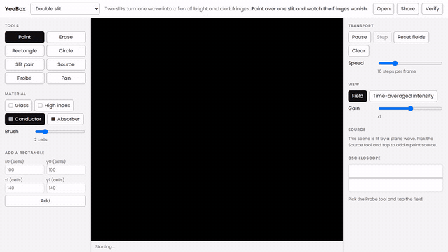
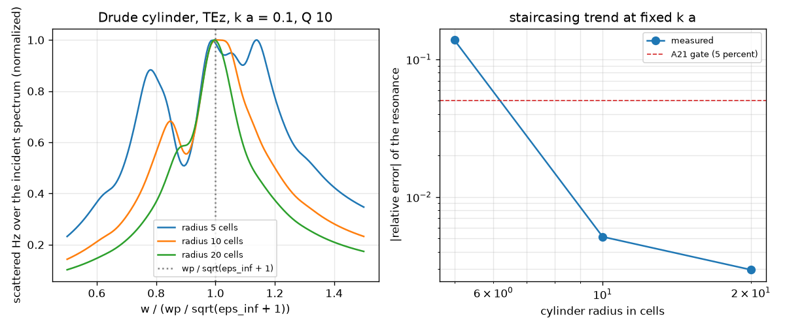

# YeeBox

Try it at https://yaasshh09.github.io/YeeBox/ (live once the site is published).

Working name. I'm building a real-time solver for Maxwell's equations that runs
in a browser tab on the GPU: you paint materials, drop a source, and watch
waves reflect, diffract, and resonate, with every frame a live FDTD solve on a
Yee grid.

That's the goal. Here's where it stands today, honestly:

- **Done:** a plain f64 CPU reference solver in Rust (1D and 2D TMz), checked
  against exact discrete identities and analytic physics; a convolutional PML
  absorbing boundary with its reflection measured in dB; an axis-aligned
  total-field / scattered-field plane wave source; and frequency-domain
  monitors that measure reflection, transmission and guided modes. On top of
  that, an f32 GPU kernel (wgpu and WGSL compute shaders) that matches the
  reference on every committed scene, and a browser app that runs it live:
  paint walls and glass, drop and drag sources, probe the field, share the
  exact scene as a link.
- **Also done:** the second polarization, TEz (electric field in the plane,
  which surface plasmons need), and frequency-dependent materials: Drude
  metals and Lorentz resonators by auxiliary differential equation, in both
  polarizations, on the CPU reference, on the GPU, and in the browser. The app
  has a TM/TE switch, silver to paint with, and three new presets: a plasmon
  on a silver wire, a silver mirror and a resonant absorber.
- **Also done:** far-field patterns. A near-to-far-field transform, checked
  against the 2D analogue of Mie theory (a PEC and an eps 4 cylinder match
  the analytic scattering width within half a decibel), against Fraunhofer
  for a double slit, and against the array factor for a steered line-source
  array. The app draws a live polar plot with the theory curve over it, and
  has a scattering cylinder and a phased array you can steer. Three scenes
  are cross-checked against Meep, and a photonic crystal's band edges
  against MPB.
- **Not done yet:** oblique plane waves, and the 3D stretch phase, where
  real antennas live. These are 2D patterns of structures infinite in z, not
  antenna patterns. I'll only claim more once its tests pass.

The reference solver stays deliberately simple. Its only job is to be
obviously correct, so it can prove the fast GPU kernel right.

## The absorbing boundary

A simulation box needs edges that swallow outgoing waves instead of bouncing
them back. I use a CPML (Roden and Gedney, with the complex frequency shift)
and I measure it rather than eyeball it: the same pulse runs in a small box
wrapped in the layer and in a huge box whose walls are too far away to matter,
and the difference at probes along the layer face is the reflection.

| Layer | Worst reflection, 0 to 70 deg | At 80 deg (grazing) |
|---|---|---|
| 10 cells | -86.5 dB | -85.5 dB |
| 16 cells | -127.3 dB | -125.4 dB |

The gate was -60 dB for 10 cells and the target -80 dB for 16 or more. I tuned
the layer parameters with a sweep against this measurement, ranking by the
worst angle including grazing, and I never tuned anything by looking at a
picture. `fdtd report` regenerates the plot and
[the full report](validation/report/report.md).

## What else is measured

| Check | Result | Gate |
|---|---|---|
| 1D pulse at the magic time step, 1000 cells | exact | 1e-12 |
| Phase velocity vs the discrete dispersion relation, 1D and 2D | 2.2e-16 | 1e-4 |
| Cavity resonances vs the discrete prediction, first six modes | 5e-10 to 3e-8 | 1e-4 |
| Cavity convergence order | 2.0014 | 1.8 to 2.2 |
| Energy drift, closed lossless cavity, 10000 steps | 3.1e-15 | 1e-10 |
| Line source vs the Hankel solution, 2 to 5 wavelengths | 3.9e-4 | 0.02 |
| Late time with the CPML, 100000 steps | decays to 4e-32 of peak, never grows | no growth |
| Plane wave leakage into the scattered-field region | -303.9 dB | -120 dB |
| Dielectric slab R and T vs the Airy formula | 4.9e-3 | 0.01 |
| R + T for the lossless slab | 1 to 6.9e-8 | 1 to 0.005 |
| Attenuation in a lossy medium | 0.40 percent | 1 percent |
| Waveguide guided wavelength and cutoff | 0.030 percent | 0.5 percent |
| Waveguide evanescent decay below cutoff | 0.060 percent | 1 percent |
| TEz against TMz under duality, vacuum line source, with reflections and a CPML | bit for bit | 1e-10 |
| Drude slab R and T vs the complex permittivity, both polarizations | 2.2e-3 | 0.02 |
| Lorentz slab R and T vs the complex permittivity, both polarizations | 4.8e-3 | 0.02 |
| Small Drude cylinder resonance vs wp / sqrt(eps_inf + 1), TEz, radius 10 cells | 0.51 percent | 5 percent |
| Energy with lossless Drude or Lorentz media, J and P included, 10000 steps | 8e-14 | 1e-10 |

For the slab, the lossy medium and the waveguide, the error that remains is
the grid's own dispersion, and I can show it: the golden data also carries the
exact answer of the discrete Yee scheme, and the measurements land on it to
1e-7 or better. The bands were picked from that prediction before any run.

The GPU kernel runs all of this too, checked against the CPU on Drude and
Lorentz scenes in both polarizations, with live painting of metal mid-run:
the worst difference is 1.2e-5 of the peak field against a 1e-4 gate, and the
browser self-test now includes the TEz Drude scene (1.3e-6).

Silver is a Drude fit (Vial et al. 2005). At the 25 nm cells of the optical
presets its skin depth is under one cell, so the app says it acts as a lossy
mirror there; the plasmon preset uses 2 nm cells, where the skin depth is
about 11. A TE box with no absorbing layer has a magnetic outer wall, not a
metal one, because that keeps it the exact mirror image of the TM box.

The Drude cylinder is the plasmon check, and it shows staircasing honestly. A
circle drawn on a square grid is not a circle, and at a radius of 5 cells the
staircase splits the surface mode into several peaks; the tallest is 14
percent off. At 10 cells the dipole peak is 0.5 percent off, and at 20 cells
0.3 percent, which is about what a cylinder that is not quite small (k a =
0.1) should show. The peak is picked blind, the tallest one, and a NumPy script
re-measures every run on its own.

## Scattering and the far field

The far field comes from a closed contour around the scene: record the fields
on it, turn them into equivalent surface currents, and integrate them out to
infinity. A line source inside the contour has to come out the same in every
direction, and it does, to 0.08 dB at 20 cells per wavelength. That number
is the grid's own error: the H field averaged onto the contour nodes is low
by about 1 percent at that resolution, and it shrinks four times when the
wavelength in cells doubles.

The real test is a cylinder in a plane wave, against the analytic series:

| Check | Result | Gate |
|---|---|---|
| Line source far field, flat in every direction, TMz and TEz | 0.080 dB | 0.1 dB |
| PEC cylinder scattering width, k a = 1, 2, 5, radius 20 cells | 0.49 dB | 1 dB |
| eps 4 cylinder scattering width, k a = 1, 2, 5, radius 40 cells | 0.28 dB | 1 dB |
| Error as the radius doubles (10, 20, 40 cells) | falls every time | falls |

I picked the radii from the resolution rule before running anything: 20
cells keeps 25 cells per wavelength at k a = 5, and inside eps 4 that needs a
radius of 40. Angles more than 20 dB below the series peak are skipped,
because deep nulls belong to the staircase. The PEC cylinder converges at
first order, which is what a staircased curved wall should do. TEz is
recorded, not gated: its staircase error is about twice the TMz one (1.8 dB
for the PEC cylinder at 20 cells, 0.8 dB at 40).

The other far-field checks:

| Check | Result | Gate |
|---|---|---|
| Double slit far field vs Fraunhofer, main lobes | 0.47 dB | 1 dB |
| Phased array beam direction vs the array factor, 0 to 45 deg | 0.08 deg | 1 deg |
| Photonic crystal Gamma-X gap edges vs MPB | 0.74 percent | 3 percent |

For the double slit I fixed the compare region from Fraunhofer's own limits
before the run: within 25 degrees of the axis, where the obliquity factor it
leaves out costs at most 0.42 dB. The crystal's reference is confirmed:
the same MPB run gives the complete band gap as 0.3225 to 0.4425 c / a,
the textbook's 0.32 to 0.44.

### Against Meep

Meep is the standard open-source FDTD package. I ran three scenes in it and
here, like for like: the same Courant number, one Meep pixel per cell, no
subpixel smoothing, and every material face placed between pixels so both
codes cover the same cells.

| Scene | YeeBox minus Meep |
|---|---|
| eps 4 cylinder, scattering width, k a = 1, 2, 5 | 0.29 dB |
| Drude slab, R and T | 1.3e-3 |
| 90 degree waveguide bend, transmission | 6.2e-3 |

The cylinder difference is the largest because the two codes staircase the
circle by different rules (my nodes count as inside when they sit on or
inside the circle, Meep fills by pixel center), and both land within 0.3 dB
of the series on their own.

The first Drude slab comparison was off by 2.4e-2. Meep's slab sat on pixel
centers and took a 21st cell; once its faces sat between pixels like mine,
the two agreed to 1.3e-3.

`fdtd validate` runs every case and prints this table with its gates;
`cargo test` checks the same cases.

## The GPU kernel

The GPU kernel is a port, not a rewrite. Every coefficient, CPML profile,
source sample and plane-wave correction is computed by the reference crate in
f64 and uploaded; the shaders hold no formula (a test checks they contain no
float literal at all). Then I run both kernels on the same scene and diff
every field.

| Check | Result | Gate |
|---|---|---|
| 11 scenes, every field, probe and spectrum, 2000 steps | 5.9e-6 worst, most near 1e-6 | 1e-4 of peak |
| Growth over 50000 steps, lossless cavity | 7.2e-6, grows like n^0.44 | no faster than n^1.2 |
| Workgroup size 4, 8, 16 | bit-identical | identical |
| Padding and wall nodes | exactly zero | zero |
| 1024 x 1024, GTX 1660 Ti | 3.0 Gcells/s, about 48 steps per 60 fps frame | 8 steps per frame |

The difference is f32 round-off measured against the peak field of the run.
It levels off instead of climbing, which is what rules out a hidden
instability. The scenes cover closed boxes, the CPML, periodic y, PEC,
lossy and dielectric shapes, every waveform, soft and hard sources, a phased
array, plane waves in all four directions and every monitor type. Any new
feature has to add a scene there.

## The browser app

The page runs the same GPU kernel through WebGPU, or the f64 CPU reference in a
Web Worker on a smaller grid when the browser has no WebGPU. It opens on a
double slit, and a drag paints a wall. There are three presets (double slit,
waveguide and cutoff, lens), tools for paint, erase, rectangles, circles, slit
pairs, sources and a probe with an oscilloscope, and a time-averaged intensity
view. Share puts the whole scene, paint included, in the URL; opening it
reproduces the scene byte for byte.

What I measured on my machine (GTX 1660 Ti):

| | |
|---|---|
| 1024 x 1024 grid in Chrome | about 2.2 Gcells/s, around 30 steps per 60 fps frame |
| Load to a running solver | 367 ms, local production build |
| First-load weight | 562 kB gzipped, budget 2 MB |
| Browser GPU vs native CPU (self-test page) | 5.1e-6 of the peak field worst, gate 1e-4 |
| Browsers checked | Chrome 157 and Firefox 159 (GPU path), headless Chromium (CPU path) |

The Verify button lists every acceptance case, and `selftest.html` runs the
GPU kernel in your browser against native reference fields shipped with the
page. I haven't measured an integrated laptop GPU, Safari, or Edge yet.

## Running it

    cargo test --workspace                       # everything, under a minute
    cargo run --release -p fdtd-cli -- validate  # every acceptance case, with gates
    cargo run --release -p fdtd-cli -- report    # regenerate validation/report
    cargo run --release -p fdtd-cli -- bench     # GPU and CPU throughput
    cargo run --release -p fdtd-cli -- run --scene validation/scenes/line_source_cpml.json

For the web app (Node 24, and `wasm-bindgen-cli` 0.2.130 to match the crate):

    cd web
    npm ci
    npm run wasm      # build the Rust side and its JS bindings
    npm run dev       # http://localhost:5173
    npm test          # unit tests
    npm run build && npx playwright test

The GPU tests need an adapter. Without one they show up as ignored, with a
banner, never as passed. `fdtd pml-sweep` reruns the layer tuning and writes a CSV ranked from best to
worst.
