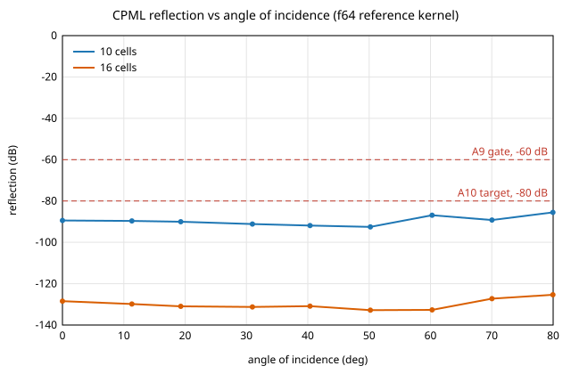
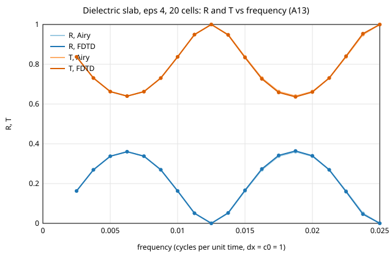

# YeeBox

Working name. I'm building a real-time solver for Maxwell's equations that runs
in a browser tab on the GPU: you paint materials, drop a source, and watch
waves reflect, diffract, and resonate, with every frame a live FDTD solve on a
Yee grid.

That's the goal. Here's where it stands today, honestly:

- **Done:** a plain f64 CPU reference solver in Rust (1D and 2D TMz), checked
  against exact discrete identities and analytic physics; a convolutional PML
  absorbing boundary with its reflection measured in dB; an axis-aligned
  total-field / scattered-field plane wave source; and frequency-domain
  monitors that measure reflection, transmission and guided modes.
- **Not done yet:** the GPU kernel, the browser app, oblique plane waves,
  dispersive materials, scattering and far-field checks. I'll only claim those
  once their tests pass.

The reference solver stays deliberately simple. Its only job is to be
obviously correct, so it can later prove the fast GPU kernel right.

## The absorbing boundary

A simulation box needs edges that swallow outgoing waves instead of bouncing
them back. I use a CPML (Roden and Gedney, with the complex frequency shift)
and I measure it rather than eyeball it: the same pulse runs in a small box
wrapped in the layer and in a huge box whose walls are too far away to matter,
and the difference at probes along the layer face is the reflection.

| Layer | Worst reflection, 0 to 70 deg | At 80 deg (grazing) |
|---|---|---|
| 10 cells | -86.5 dB | -85.5 dB |
| 16 cells | -127.3 dB | -125.4 dB |

The gate was -60 dB for 10 cells and the target -80 dB for 16 or more. I tuned
the layer parameters with a sweep against this measurement, ranking by the
worst angle including grazing, and I never tuned anything by looking at a
picture. `fdtd report` regenerates the plot and
[the full report](validation/report/report.md).

## What else is measured

| Check | Result | Gate |
|---|---|---|
| 1D pulse at the magic time step, 1000 cells | exact | 1e-12 |
| Phase velocity vs the discrete dispersion relation, 1D and 2D | 2.2e-16 | 1e-4 |
| Cavity resonances vs the discrete prediction, first six modes | 5e-10 to 3e-8 | 1e-4 |
| Cavity convergence order | 2.0014 | 1.8 to 2.2 |
| Energy drift, closed lossless cavity, 10000 steps | 3.1e-15 | 1e-10 |
| Line source vs the Hankel solution, 2 to 5 wavelengths | 3.9e-4 | 0.02 |
| Late time with the CPML, 100000 steps | decays to 4e-32 of peak, never grows | no growth |
| Plane wave leakage into the scattered-field region | -303.9 dB | -120 dB |
| Dielectric slab R and T vs the Airy formula | 4.9e-3 | 0.01 |
| R + T for the lossless slab | 1 to 6.9e-8 | 1 to 0.005 |
| Attenuation in a lossy medium | 0.40 percent | 1 percent |
| Waveguide guided wavelength and cutoff | 0.030 percent | 0.5 percent |
| Waveguide evanescent decay below cutoff | 0.060 percent | 1 percent |

For the slab, the lossy medium and the waveguide, the error that remains is
the grid's own dispersion, and I can show it: the golden data also carries the
exact answer of the discrete Yee scheme, and the measurements land on it to
1e-7 or better. The bands were picked from that prediction before any run.

`fdtd validate` runs every case and prints this table with its gates;
`cargo test` checks the same cases.

## Running it

    cargo test --workspace                       # everything, under a minute
    cargo run --release -p fdtd-cli -- validate  # every acceptance case, with gates
    cargo run --release -p fdtd-cli -- report    # regenerate validation/report
    cargo run --release -p fdtd-cli -- run --scene validation/scenes/line_source_cpml.json

`fdtd pml-sweep` reruns the layer tuning and writes a CSV ranked from best to
worst.
