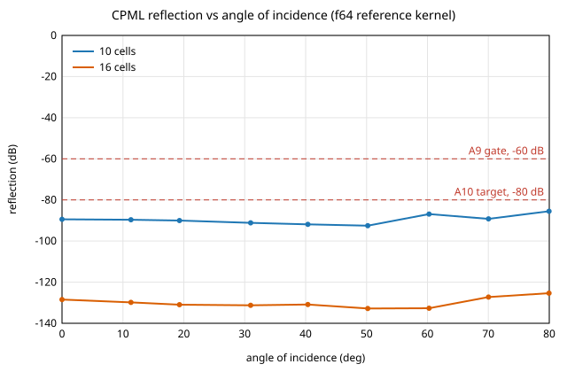
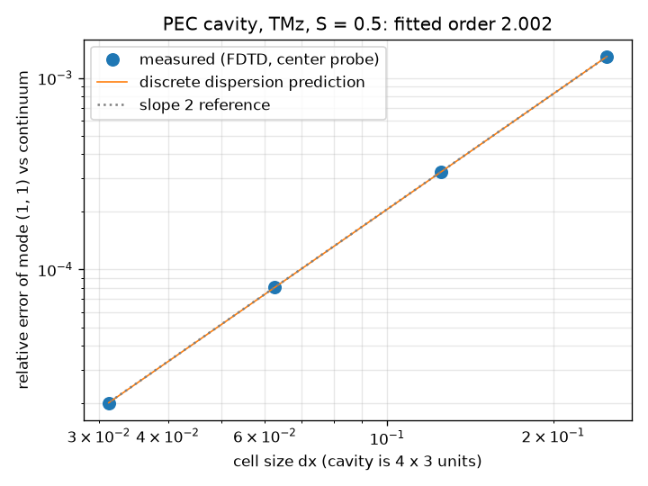
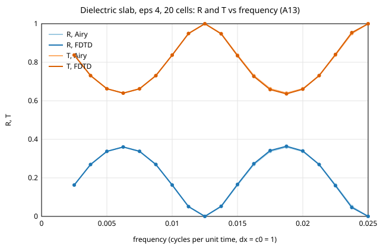
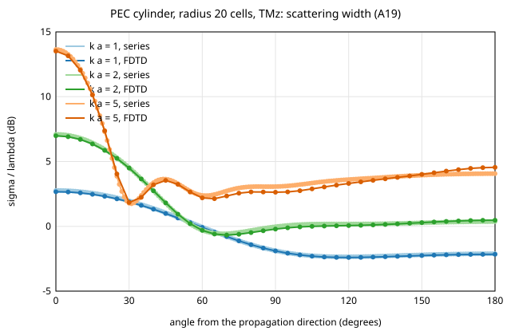
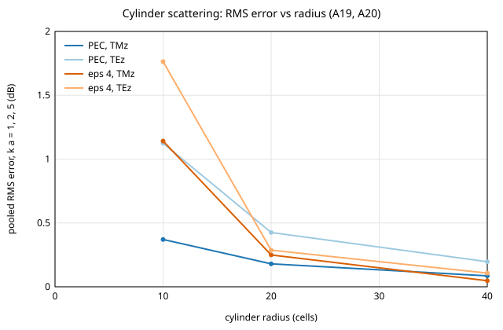
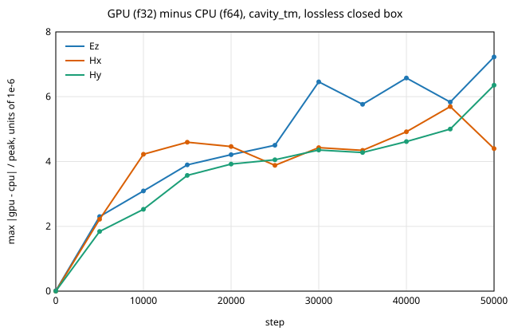

# Validation report

`fdtd report` writes this file, so I regenerate it instead of editing it.

## CPML reflection (A9, A10)

I measure it with the reference-domain method. A Ricker pulse (spectral peak at 20 cells per wavelength, S = 0.5) starts 20 cells above the bottom interface of a 165 x 60 node vacuum box. I record Ez on the interface row, where the direct wave meets the layer at each angle, and at the interface corner, then compare with the same box inside PEC walls so far away that nothing comes back within the 1000 step window. Per probe, R = 20 log10(max |test - reference| / max |reference|). Everything runs on the f64 reference kernel.

| Probe | Angle (deg) | 10 cells (dB) | 16 cells (dB) |
|---|---|---|---|
| interface | 0.0 | -89.41 | -128.47 |
| interface | 11.3 | -89.63 | -129.85 |
| interface | 19.3 | -90.02 | -130.94 |
| interface | 31.0 | -91.15 | -131.27 |
| interface | 40.4 | -91.89 | -130.86 |
| interface | 50.2 | -92.52 | -132.82 |
| interface | 60.3 | -86.88 | -132.66 |
| interface | 70.0 | -89.23 | -127.25 |
| interface | 80.0 | -85.51 | -125.37 |
| corner | 51.3 | -86.47 | -132.86 |

| Check | Layer | Gate | Worst, 0 to 70 deg | Result |
|---|---|---|---|---|
| A9 | 10 cells: m = 3, sigma_scale = 1.25, kappa_max = 2, alpha_max = 0.15 | at most -60 dB | -86.47 dB | pass |
| A10 | 16 cells: m = 4, sigma_scale = 1, kappa_max = 2, alpha_max = 0.1 | -80 dB target | -127.25 dB | pass |

The layers are `PmlSpec::recommended`, tuned with `fdtd pml-sweep` against the worst reflection over every probe above, grazing 80 degrees included.

## Cavity convergence (A7)

`validation/gen/plot_cavity_convergence.py` makes this plot. It re-measures the resonances in NumPy on its own, as a cross-check of the Rust test.

## Every case

`fdtd validate` prints the same table. Each gate is the one in `docs/04-validation.md`; the conditions column says what was run.

| Case | Check | Measured | Gate | Result | Conditions |
|---|---|---|---|---|---|
| A1 | 1D magic time step, shape after 1000 cells | 0 rel | <= 1.00e-12 | pass | S = 1, Gaussian tau 10 |
| A2 | 1D phase velocity vs discrete relation | 0 rel | <= 1.00e-4 | pass | S = 0.5, 10, 20, 40 cpw; discrete vs continuum 1.3e-2 at 10 cpw |
| A3 | 1D PEC reflection inverted, equal magnitude | 2.11e-15 rel | <= 1.00e-10 | pass | S = 1 direct 2.1e-15, S = 0.5 image method 0.0e0 |
| A4 | 2D stability, bounded at S = 0.70 | 3.9674 x start | <= 10 | pass | 32 x 32 box, 20000 steps; S = 0.72 passed 1e6x at step 44 |
| A5 | 2D dispersion, axis and diagonal vs discrete | 2.22e-16 rel | <= 1.00e-4 | pass | S = 0.5, guided modes: diagonal 9.9 cpw, diagonal 19.8 cpw, 4.4 deg 10 cpw, 9.0 deg 20 cpw |
| A6 | PEC cavity, first 6 resonances vs discrete | 3.18e-8 rel | <= 1.00e-4 | pass | 40 x 23 cells, S = 0.5; mode (1, 1) discrete vs continuum 3.9e-4 |
| A7 | PEC cavity convergence to continuum | 2.0014 order | 1.8 to 2.2 | pass | 4L x 3L, L = 4..32; error 1.29e-3 at L = 4, 2.01e-5 at L = 32 |
| A8 | line source vs Hankel, 2 to 5 wavelengths | 3.85e-4 rel | <= 0.02 | pass | axis and diagonal, f0 = 0.05, 16-cell layer; with the continuum k 5.9e-2 |
| A9 | CPML reflection, 10 cells | -86.466 dB | <= -60 | pass | 10 cells, 0 to 70 deg, worst with 80 deg -85.5 dB |
| A10 | CPML reflection, tuned 16 cells | -127.2532 dB | <= -80 | pass | 16 cells, 0 to 70 deg, worst with 80 deg -125.4 dB |
| A11 | waveguide cutoff and guided wavelength | 2.96e-4 rel | <= 5.00e-3 | pass | TM1, a = 40, 1.30 and 1.60 f_c; guided wavelength 3.0e-4, cutoff 1.8e-5 |
| A12 | waveguide evanescent decay below cutoff | 6.04e-4 rel | <= 0.01 | pass | TM1, a = 40, 0.70 f_c; vs exact discrete 7.8e-8 |
| A13 | dielectric slab R and T vs Airy | 4.88e-3 abs | <= 0.01 | pass | eps 4, 20 cells, f 0.0025 to 0.025; vs exact discrete 1.4e-7; order 2.006 over L = 20, 40, 80 |
| R+T | R + T = 1, lossless slab | 6.87e-8 abs | <= 5.00e-3 | pass | the A13 slab at L = 20 |
| A14 | lossy medium attenuation vs analytic | 4.00e-3 rel | <= 0.01 | pass | eps 2.25, sigma 0.05, f 0.008 to 0.02; vs exact discrete 2.5e-6 |
| A15 | TF/SF leakage, empty domain | -303.9111 dB | <= -120 | pass | all four directions, closed box and periodic y |
| A16 | Drude slab R and T vs complex eps | 2.18e-3 abs | <= 0.02 | pass | 20 cells, f 0.004 to 0.045 (42 points), TMz 6.2e-4, TEz 2.2e-3 |
| A17 | Lorentz slab R and T vs complex eps | 4.79e-3 abs | <= 0.02 | pass | 20 cells, f 0.004 to 0.045 (41 points), TMz 4.8e-3, TEz 4.7e-3 |
| A18 | TEz vs TMz under duality, vacuum line source | 0 rel | <= 1.00e-10 | pass | 121 x 101, 1500 steps; closed box 0.0e0, CPML 16 0.0e0; probe 0.0e0; unshifted source 1.3e-1 |
| A21 | Drude cylinder resonance vs wp / sqrt(eps_inf + 1), TEz | 5.14e-3 rel | <= 0.05 | pass | k a = 0.1, Q 10; radius 10 cells +5.14e-3, 5 cells +1.38e-1 |
| NTFF | line source far field isotropy | 0.0797 dB | <= 0.1 | pass | contour 41 x 41 around the source; Tm f 0.025 0.0052 dB, Tm f 0.05 0.0797 dB, Te f 0.025 0.0052 dB, Te f 0.05 0.0797 dB |
| A19 | PEC cylinder scattering width | 0.4851 dB | <= 1 | pass | TMz, radius 20 cells, k a = 1, 2, 5: 0.100, 0.187, 0.485 dB; TEz recorded: 0.441, 0.625, 1.793 dB; angles within 20 dB of the series peak |
| A19 conv | error falls as the radius doubles | 0.4846 ratio | <= 1 | pass | pooled RMS dB at a = 10, 20, 40: TMz 0.370, 0.179, 0.086 (order 1.05), TEz 1.124, 0.425, 0.197 (order 1.26) |
| A20 | dielectric cylinder scattering width | 0.2772 dB | <= 1 | pass | TMz, radius 40 cells, k a = 1, 2, 5: 0.015, 0.055, 0.277 dB; TEz recorded: 0.320, 0.254, 0.377 dB; angles within 20 dB of the series peak |
| A20 conv | error falls as the radius doubles | 0.2186 ratio | <= 1 | pass | pooled RMS dB at a = 10, 20, 40: TMz 1.141, 0.250, 0.048 (order 2.29), TEz 1.764, 0.287, 0.107 (order 2.02) |
| A22 | double slit far field | 0.4657 dB | <= 1 | pass | slits 2 lambda wide, 5 lambda apart, 20 cells per wavelength, TMz; 25 angles with /theta/ <= 25 deg within 10 dB of the peak |
| A23 | phased array beam direction | 0.0843 deg | <= 1 | pass | 8 line sources, lambda / 2 apart, true time delays, TMz; 0 deg: -0.00 vs -0.00, 15 deg: 14.93 vs 15.00, 30 deg: 30.00 vs 30.00, 45 deg: 44.92 vs 45.00 |
| A24 | photonic crystal Gamma-X gap edges | 7.44e-3 rel | <= 0.03 | pass | T below -10 dB from 0.2739 to 0.4458 c / a, MPB band edges 0.2747 to 0.4425 (the edges moved 3.7e-5 over the last quarter of 40000 steps); eps 8.9 rods, r = 0.2 a, a = 40 cells, 8 rows, normal incidence |

## Dielectric slab (A13)

The measured curves sit on the exact discrete slab to 1e-7; what separates them from Airy is the grid's own dispersion, 4.9e-3 at the band edge, as the golden file predicts. The numbers are in `slab_rt.csv`.

## Cylinder scattering (A19, A20)

A plane wave on a cylinder, the 2D analogue of Mie theory. The far field comes from a closed contour in the scattered-field region (`ntff.rs`); the series is `validation/gen/cylinder_series.py`. The comparison skips angles more than 20 dB below the series peak, where staircasing owns the deep nulls.

The error falls every time the radius in cells doubles. The PEC cylinder in TMz converges at first order, as a staircased curved wall should; TEz staircasing is worse, so TEz is recorded and not gated.

## Meep cross-check (Tier 5)

         Three scenes run in Meep 1.35.1 (offline, in WSL; `validation/meep/`, versions in `environment.txt`) and here, like for like: Courant 0.5, one Meep pixel per cell, no subpixel smoothing. Meep is a second implementation, not the reference, so these are recorded. MPB, from the same install, gives the A24 band edges.

| Case | Check | Measured | Gate | Result | Conditions |
|---|---|---|---|---|---|
| T5 cylinder | eps 4 cylinder, YeeBox minus Meep | 0.2856 dB | recorded | recorded | radius 40 cells, TMz, k a = 1, 2, 5, the A20 angles; Meep itself is 0.296 dB from the series |
| T5 Drude | Drude slab, YeeBox minus Meep | 1.29e-3 abs | recorded | recorded | the A16 slab, TMz, worst of R and T; Meep itself is 1.79e-3 from the analytic R, T |
| T5 bend | waveguide bend transmission, YeeBox minus Meep | 6.22e-3 abs | recorded | recorded | the Meep tutorial bend, eps 12 guide 10 cells wide, 100 frequencies |

## GPU against CPU (Tier 4)

Adapter: NVIDIA GeForce GTX 1660 Ti (Vulkan). Each entry is max |gpu - cpu| over the array divided by the reference peak so far, the worst over checkpoints every 250 steps up to 2000; gate 0.0001.

| Scene | Ez | Hx | Hy | Probes | Spectra | Result |
|---|---|---|---|---|---|---|
| cavity_tm | 1.02e-6 | 1.16e-6 | 1.07e-6 | 1.33e-6 | 0.00e0 | pass |
| drude_te | 3.94e-7 | 6.33e-7 | 1.67e-6 | 7.56e-7 | 5.72e-7 | pass |
| drude_tm | 2.63e-6 | 8.42e-6 | 4.55e-6 | 1.18e-6 | 2.76e-7 | pass |
| hard_sources | 1.22e-6 | 1.29e-6 | 1.03e-6 | 9.83e-7 | 0.00e0 | pass |
| line_source_cpml | 5.70e-7 | 6.98e-7 | 9.48e-7 | 1.39e-6 | 0.00e0 | pass |
| lorentz_te | 6.86e-7 | 8.85e-6 | 6.94e-6 | 6.17e-6 | 5.29e-6 | pass |
| lorentz_tm | 3.56e-7 | 3.47e-6 | 2.73e-6 | 1.15e-5 | 0.00e0 | pass |
| materials_clutter | 5.61e-7 | 1.37e-6 | 1.57e-6 | 6.21e-7 | 1.86e-7 | pass |
| ntff_array_te | 4.50e-6 | 2.05e-5 | 1.46e-5 | 0.00e0 | 3.94e-8 | pass |
| ntff_cylinder_tm | 3.81e-7 | 3.43e-7 | 4.56e-7 | 0.00e0 | 6.88e-8 | pass |
| painted_walls | 2.04e-6 | 9.13e-6 | 6.90e-6 | 4.07e-7 | 0.00e0 | pass |
| phased_array_cpml | 6.60e-7 | 1.03e-6 | 1.23e-6 | 1.29e-6 | 4.38e-8 | pass |
| preset_absorber_compact | 8.39e-7 | 2.33e-6 | 1.88e-6 | 0.00e0 | 0.00e0 | pass |
| preset_array_compact | 4.70e-7 | 1.13e-6 | 1.36e-6 | 0.00e0 | 2.74e-8 | pass |
| preset_double_slit_compact | 7.96e-7 | 1.42e-6 | 2.68e-6 | 0.00e0 | 3.77e-8 | pass |
| preset_lens_compact | 7.28e-7 | 1.71e-6 | 1.40e-6 | 0.00e0 | 0.00e0 | pass |
| preset_mirror_compact | 2.68e-7 | 1.89e-6 | 3.03e-6 | 0.00e0 | 0.00e0 | pass |
| preset_plasmon_compact | 3.86e-6 | 1.19e-5 | 1.11e-5 | 0.00e0 | 0.00e0 | pass |
| preset_scattering_compact | 9.66e-7 | 1.64e-6 | 1.58e-6 | 0.00e0 | 2.49e-5 | pass |
| preset_waveguide_compact | 1.54e-6 | 2.47e-6 | 1.83e-6 | 0.00e0 | 0.00e0 | pass |
| slab_tfsf | 3.75e-7 | 0.00e0 | 4.97e-7 | 0.00e0 | 6.05e-5 | pass |
| te_materials_cpml | 7.21e-7 | 1.72e-6 | 1.24e-6 | 4.71e-7 | 1.94e-8 | pass |
| te_tfsf_rod_plus_y | 2.72e-7 | 4.03e-7 | 5.48e-7 | 5.87e-6 | 2.03e-5 | pass |
| tfsf_cylinder_plus_y | 3.85e-7 | 4.07e-7 | 8.21e-7 | 4.05e-7 | 5.28e-8 | pass |
| tfsf_lossy_minus_y | 8.34e-7 | 1.53e-6 | 2.73e-6 | 8.14e-7 | 1.89e-7 | pass |
| tfsf_rod_minus_x | 3.44e-7 | 1.02e-6 | 4.98e-7 | 3.26e-7 | 6.32e-6 | pass |
| tfsf_thin_plus_x | 3.33e-6 | 5.91e-6 | 4.66e-6 | 2.28e-7 | 0.00e0 | pass |
| waveguide_tm | 1.22e-6 | 2.01e-6 | 1.75e-6 | 0.00e0 | 6.10e-8 | pass |

Over 50000 steps the worst difference reaches 7.23e-6 of the peak field; a least-squares fit gives growth like n^0.44 (bound 1.2, linear would be 1).
